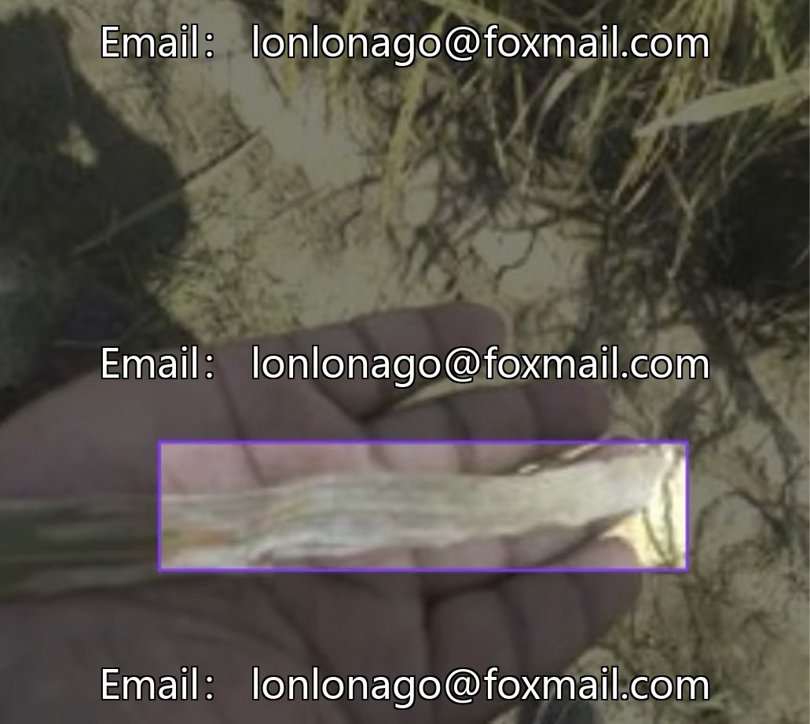
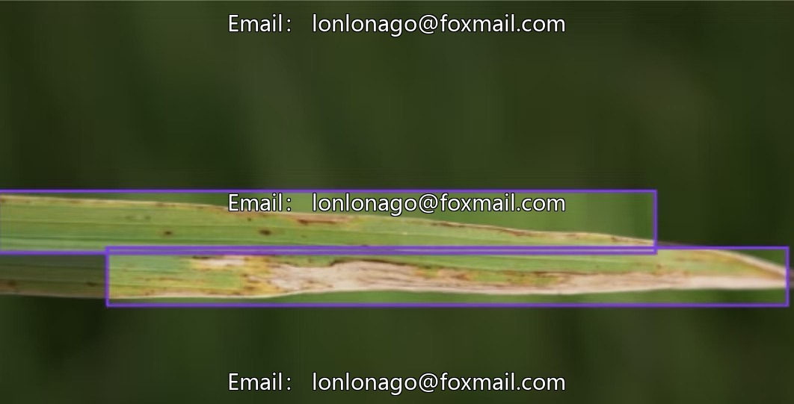
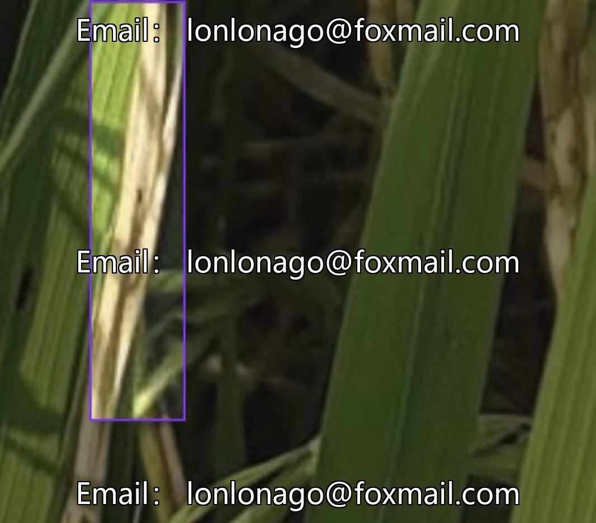

# Intelligent Agriculture Only Rice Leaf Disease Detection Dataset, focusing on rice bacterial stripe disease and rice blast

## Body

The dataset for intelligent agriculture, specifically designed for the detection of rice leaf diseases, focuses on three major common diseases: bacterial stripe disease, blast fungus disease, and brown spot disease. It includes over 1300 high-quality labeled images in txt format that supports YOLO standards, with category indices and normalized coordinates. The data is divided into train/valid/test partitions, accompanied by a data.yaml configuration file.

The image covers multiple lighting conditions, various growth stages, and complex field backgrounds. The disease categories are diverse, suitable for intelligent agricultural scenarios such as drone inspection and mobile device diagnosis, enhancing the model's generalization capability.

Virtual materials, once sold, are non-refundable.
Interested friends, click "I want" to proceed.

## Images

## Payment

Here is a pay link on Stripe ( https://buy.stripe.com/3cs8yP7sY87d0vu9AB ). Please contact me lonlonago@foxmail.com after funding $89, and I will send you a complete data files , thank you!

